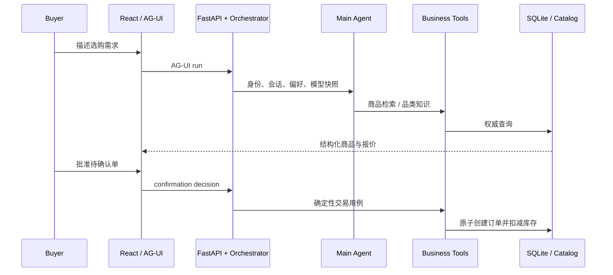

# 架构说明

Globex Agent 将模型判断与业务权威状态分开。模型可以选择工具和生成自然语言，但不能直接修改库存、订单、确认状态或价格快照。所有有副作用的交易均由应用层用例和 SQLite 事务执行。

## 分层

- `app/domain`：Money、Product、SKU、Order、Address 等实体与端口。
- `app/application`：Agent 编排、业务用例、工具合同、上下文和记忆策略。
- `app/infrastructure`：模型、检索、Qdrant、SQLite、缓存、队列与观测适配。
- `app/presentation`：FastAPI、AG-UI、传统 HTTP 路由与 DTO。
- `frontend`：React/TypeScript 页面，只渲染结构化商品、确认和订单事实。
- `eval`、`scripts/eval`：数据集、指标、Harness、公开业务基线和证据生成。

## 请求路径

## 关键工程决策

1. **确认边界**：Agent 只能准备操作，批准必须来自用户界面；拒绝不产生副作用。
2. **事务与幂等**：确认、订单和库存同事务提交；重复批准返回相同结果，不重复扣库存。
3. **价格连续性**：结构化报价保存商品、运费、关税、币种与合计，后续阶段读取同一快照。
4. **检索降级**：向量检索和 reranker 不可用时可显式降级，硬约束继续由代码过滤。
5. **Embedding 身份隔离**：知识集合绑定规范化 endpoint、模型、版本与维度，避免同维换模型复用旧向量。
6. **可恢复运行**：会话、AG-UI 事件、确认和订单保存在服务端，浏览器缓存只用于加速。
7. **付费评测隔离**：CI 默认只运行免密钥合同；真实模型评测必须手动 opt-in。

## 为后续训练保留的边界

`learning_store` 与学习导出脚本可保存候选、反馈和训练数据发件箱。它们是数据接口，不是 RL 训练接口；当前没有 reward model、PPO/GRPO 训练器或权重部署流程。未来训练模型仍通过现有模型适配层接入，业务工具与交易合同保持不变。
