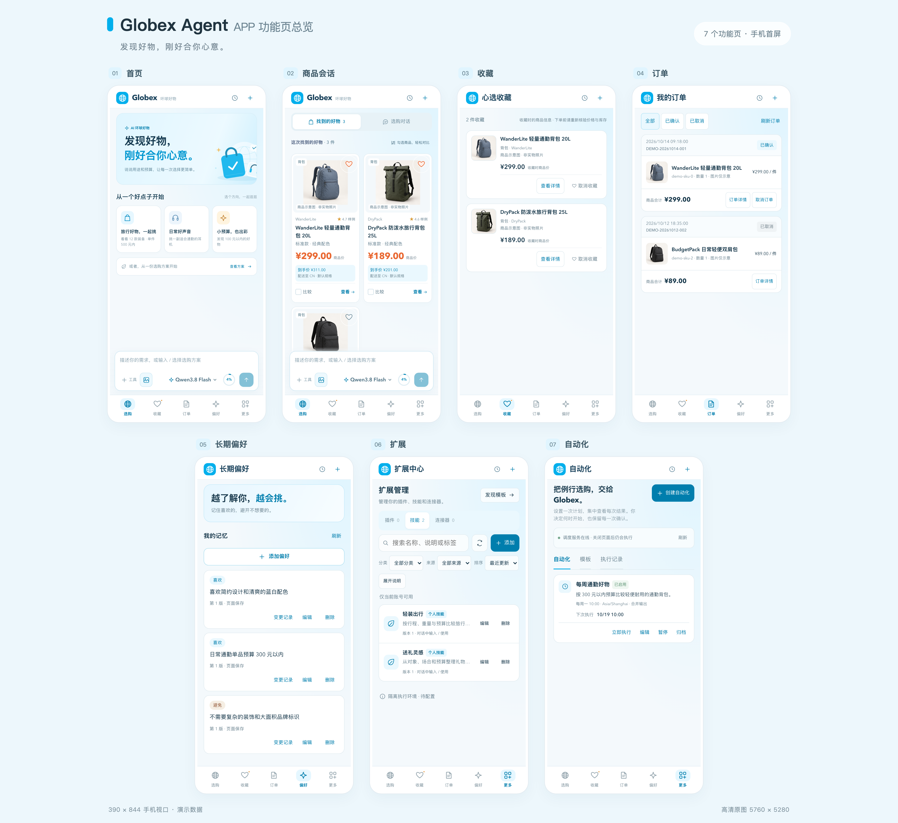
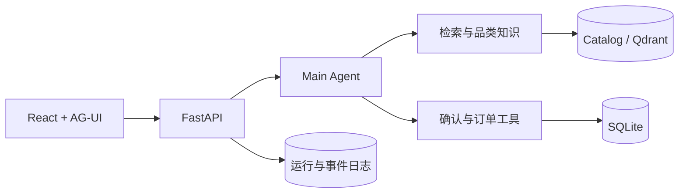

# Globex Agent · 可评测的跨境电商购物 Agent

Globex Agent 是一个基于 **AgentScope 2.x、FastAPI、AG-UI、React 与 SQLite** 的跨境电商选购工程：模型负责理解需求和选择工具，代码负责价格、库存、确认与订单等权威状态。



| 可复现结果 | 当前公开结果 | 边界 |
| --- | ---: | --- |
| 业务合同基线 | **18 / 18** | 人工精选的确定性场景，不代表业务覆盖率或模型能力 |
| Harness 契约门 | **874 collected；873 passed；1 个显式平台豁免** | 无模型凭据的安全、协议与工程合同 |
| 前端回归 | **252 passed + production build** | React 组件与页面状态合同 |

## 30 秒理解项目

买家可以用自然语言说明预算、目的地和商品约束。Agent 调用商品检索、品类知识、偏好与订单工具；页面通过 AG-UI 流式展示回答、商品卡和待确认操作。下单与取消都必须经过人工确认，SQLite 事务保证库存只扣减或补回一次，到手价快照贯穿检索、确认、订单和取消。



详细设计见 [ARCHITECTURE.md](ARCHITECTURE.md)，评测边界见 [EVALUATION.md](EVALUATION.md)。

## 本机启动

需要 Python 3.11–3.13、[uv](https://docs.astral.sh/uv/)、Node.js 22，以及支持 OpenAI Chat Completions、流式输出和工具调用的模型服务。

```bash
uv sync --frozen
npm --prefix frontend ci
cp .env.example .env  # 仅在本机还没有 .env 时执行
```

在 `.env` 中配置 `LLM_BASE_URL`、`LLM_API_KEY` 和 `LLM_MODEL`。不要提交 `.env`。

```bash
# 终端 1
uv run python -m uvicorn app.presentation.server:app --host 127.0.0.1 --port 8000 --workers 1

# 终端 2
npm --prefix frontend run dev -- --host 127.0.0.1 --port 5173 --strictPort
```

打开 <http://127.0.0.1:5173>，后端健康检查为 <http://127.0.0.1:8000/health>。

受限环境若无法使用 uv 缓存，可指定已有虚拟环境：

```bash
make baseline PUBLIC_BASELINE_PYTHON=.venv/bin/python
```

## 可以演示的完整业务链

1. 多轮补充预算、目的地、颜色和商品规格。
2. 检索版本化商品目录，展示商品、运费、关税与到手价。
3. Agent 只能准备待确认单，不能替用户批准。
4. 用户批准后创建本地合成订单并扣减一次库存。
5. 取消也需要二次确认；批准后恢复一次库存。
6. 刷新页面后，从服务端恢复会话、确认和订单终态。

工程还包含长期偏好、个人 Skill、自动化任务、模型配置、上下文治理、运行日志和评测 Harness。训练数据发件箱可以导出候选轨迹，但仓库**不包含训练器，尚未进行 SFT 或 RL**。

## 无密钥验证

```bash
make baseline
uv run python -m scripts.eval.harness run --suite eval/harness/v1/suite.json --profile contracts --output .globex-runtime/contracts
npm --prefix frontend test -- --run
npm --prefix frontend run build
```

`make baseline` 必须实际执行 18 个场景，每个 nodeid 恰好执行一次；错误、跳过或未执行都会返回非零。公开结论与 SHA-256 清单位于 [eval/verification/public](eval/verification/public)。真实模型评测在 GitHub Actions 中默认关闭，只能手动明确选择。

GitHub Actions 按职责分为两道门：`Harness regression` 运行后端契约、18 场景基线与公开证据哈希校验；`Frontend regression` 运行前端测试、生产构建和依赖审计门。两者都对各自守护的源码、配置、校验器和证据输入设置 push / pull request 路径触发。具体的自动与人工发布边界见 [PUBLIC_RELEASE_RUBRIC.md](PUBLIC_RELEASE_RUBRIC.md)。

## 一次真实故障如何被门禁发现

私有源仓的首次 Linux CI 因一个仅适用于 Windows 的用例被跳过而失败。修复没有放宽契约门，而是把唯一例外绑定到精确 nodeid、平台和原因；未声明的 skip、原因不符或已经失效的白名单都会继续失败。这段红到绿过程体现了门禁会真实阻断。新公开仓自己的云端结果只在发布后单独验收，不能由这段历史替代。

## 范围与许可

商品、地址、订单和库存均为本地合成数据；未接入真实支付、物流或商家供给。真实模型效果、远端 Qdrant、生产多租户和 RL 训练不在当前结论范围内。本版本是本机源码作品集，不批准直接部署为公网服务，详见 [LIMITATIONS.md](LIMITATIONS.md) 与 [SECURITY.md](SECURITY.md)。

本仓库用于个人作品集展示。除仓库内第三方组件自带的许可证外，未授予复制、修改或再分发本项目源代码的开源许可，详见 [LICENSE](LICENSE)。
